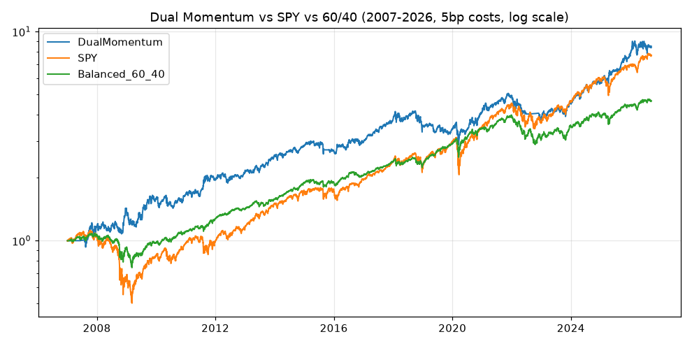

# dual-momentum

A clean, honest backtest of a classic **Dual Momentum** ETF rotation (2007–2026), with two baselines
and three robustness checks fixed in advance — and reported as they came out, including the failures.

## Rule

- Universe: SPY, QQQ, EFA, EEM, TLT, GLD; safe asset BIL.
- On the last trading day of each month, rank the six risky ETFs by 6-month (126-day) return.
- Hold the **top 2 with positive return**, 50/50. If none is positive — BIL.
- Signal on the close, position from the next trading day. Costs 5 bp one-way on turnover.
- No parameter optimisation: lookback, top-N and tickers were fixed before the run; lookback
  sensitivity is a diagnostic only.

## Results (2007-01-01 … 2026-09-20)

| strategy | CAGR | Vol | Sharpe | Max DD | Calmar | Monthly hit rate | Turnover / yr |
|---|---|---|---|---|---|---|---|
| **Dual Momentum** | **11.50%** | 15.95% | **0.76** | **−31.1%** | **0.37** | 60.6% | 3.19 |
| SPY buy & hold | 10.95% | 19.56% | 0.63 | −55.2% | 0.20 | 65.7% | — |
| 60/40 (SPY/TLT) | 8.15% | 11.17% | 0.76 | −31.4% | 0.26 | 66.5% | 0.16 |



**Verdict:** beats SPY on Sharpe and roughly halves the max drawdown, but only *ties* a plain 60/40
on Sharpe. The edge over 60/40 is higher return at the same risk-adjusted level, not better risk-adjusted
return.

### Pre-set robustness checks

| check | criterion | result |
|---|---|---|
| Crash 2008 | intra-year drawdown < 20% | +20.0%, DD −12.8% — **OK** |
| Crash 2020 | intra-year drawdown < 20% | +20.4%, DD −22.0% — **FAIL** |
| Crash 2022 | intra-year drawdown < 20% | −22.5%, DD −23.7% — **FAIL** (stocks and bonds fell together; monthly signal too slow) |
| Split test | Sharpe ratio between 2007–15 and 2015–26 ≤ 1.5× | 0.87 vs 0.68, 1.27× — **OK** |
| Lookback sensitivity (diagnostic) | Sharpe deviation ≤ 50% | 3m 0.88 / 6m 0.76 / 9m 0.62 / 12m 0.75, max 18% — **OK** |

Note the decay: Sharpe fell from 0.87 in the first half to 0.68 in the second.

## Implementation notes

- Cash is tracked as an explicit balance. The first version held "zero units" of not-yet-listed tickers;
  `0 × NaN` (BIL before 2007-05-30) silently wiped the NAV to −100%.
- Before BIL exists and before 6 months of history accumulate, the strategy holds pure cash rather than
  "100% BIL" at a NaN price.
- Turnover is measured against the *drifted* weights on each rebalance date.

## Run

```bash
pip install pandas numpy yfinance pyarrow matplotlib
python run.py      # downloads prices, runs everything, writes results/
```
